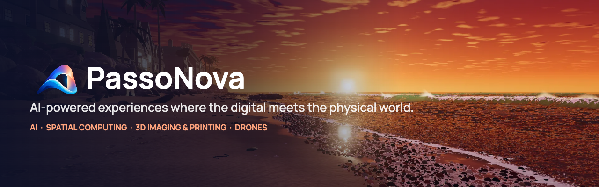

  

  <a href="https://passonova.com"><b>passonova.com</b></a> ·
  <a href="https://www.linkedin.com/company/passonova">LinkedIn</a> ·
  <a href="mailto:hello@passonova.com">hello@passonova.com</a>

---

**PassoNova builds AI-powered products and experiences where the digital meets the physical world** —
at the intersection of four technologies that just became capable and affordable at the same time.

| Technology | What it brings |
|---|---|
| 🧠 **AI** | Agents that reason over real data and real places, show their evidence, and hand uncertain decisions to a person. |
| 🥽 **Spatial computing** | AR, VR and mixed reality on visionOS and other headsets, putting people inside the space they're working on. |
| 🧊 **3D imaging & printing** | Real spaces and objects captured as photoreal 3D twins, and designs turned into physical parts. |
| 🛩️ **Drones** | Aerial capture and inspection that bring sites and structures into the same 3D, AI-ready picture. |

### Now building

**Home renovation, reimagined with AI and spatial computing** — an experience that brings homeowners,
suppliers and contractors together around the real space. The first of more use cases to come.

**visionOS feature demos** — playable games that preview the building blocks behind our products.

### How we build

- **Evidence-first AI.** Every recommendation carries its evidence and a confidence score; uncertain or
  high-risk decisions go to a person.
- **Model-agnostic.** Workloads are routed across local and cloud models by cost, privacy, latency,
  capability and confidence.
- **Real-time 3D on the web and in headsets.** Our website's hero is a live three.js ocean whose every wave
  is timed to a field recording from a pebble beach.

### Open source

| Project | |
|---|---|
| [**mcp-linkedin-manager**](https://github.com/PassoNova/mcp-linkedin-manager) | Manage your LinkedIn profile, posts and certifications from your agentic coding tool, using the official LinkedIn API. |

PassoNova LLC · Oceanside, California · *Where the real meets the imagined.*
